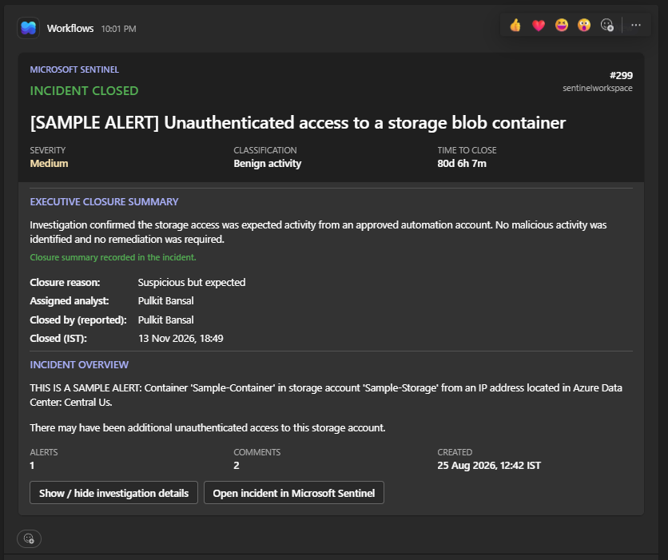
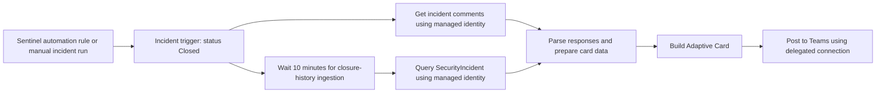

# Microsoft Sentinel Closed Incident Notifications for Microsoft Teams

Send Microsoft Sentinel incident closure summaries directly to a Microsoft Teams channel with an Azure Logic Apps playbook. Give security operations teams, incident managers, and stakeholders a consistent view of the recorded outcome, classification, ownership, and investigation context.

Deploy the Azure Resource Manager (ARM) template, connect your Teams destination, and use a Sentinel automation rule to notify the channel when an incident is closed. No generative AI, application registration, or client secret is required.

[](https://portal.azure.com/#create/Microsoft.Template/uri/https%3A%2F%2Fraw.githubusercontent.com%2FRGurjar-cloud%2Fsentinel%2Fmain%2FclosedIncidentadaptivecard%2Fazuredeploy.json)

**Deployment at a glance:** one Consumption Logic App, two API connections, and an automatically created system-assigned managed identity. The workflow starts **disabled** so you can finish permissions and Teams authorization before sending notifications.

## Sample notification



*Example notification using a sample incident. Incident content comes from your workspace. This image uses IST; new deployments default to UTC.*

## Contents

- [Overview](#overview)
- [Before you deploy](#before-you-deploy)
- [Deploy and configure](#deploy-and-configure)
- [Copy-paste into an existing Logic App](#copy-paste-into-an-existing-logic-app)
- [Deployment parameters](#deployment-parameters)
- [Troubleshooting](#troubleshooting)
- [Repository contents](#repository-contents)
- [Additional technical information](#additional-technical-information)
- [Microsoft documentation](#microsoft-documentation)

## Overview

This Microsoft Sentinel playbook posts an Adaptive Card to a standard Microsoft Teams channel when an incident is closed.

### What the notification includes

- **Incident context:** title, incident number, workspace, severity, description, and alert count when available.
- **Closure summary:** the recorded classification comment, classification, and closure reason.
- **Ownership and timing:** assigned analyst, reported closure source, creation time, closure time, and time to close.
- **Investigation details:** the latest three comments, UTC audit timestamps, incident identifier, and data-quality notes in an expandable section.
- **Direct incident access:** a link back to the incident for the complete investigation.

### What stays unchanged

The playbook is **read-only against Sentinel**. It does not close incidents, change their classification, add comments, or perform remediation. It presents recorded incident data rather than generating an AI summary. When closure history is unavailable, the card explicitly identifies the missing information.

Use one deployment per source workspace and Teams destination. This package is a standalone ARM template, not a Sentinel Content Hub solution.

## Before you deploy

Have the following ready:

| Requirement | What you need |
|---|---|
| Azure subscription | A resource group for the playbook in a region supporting Consumption Logic Apps and both managed connectors. |
| Microsoft Sentinel | An existing Sentinel-enabled Log Analytics workspace in the same Microsoft Entra tenant as the Logic App. |
| Incident history | `SecurityIncident` data in that workspace for closure-history enrichment. |
| Microsoft Teams | A commercial Microsoft 365 tenant, a standard channel, and a licensed account permitted to authorize the connection and post to the channel. |
| Teams app policy | The **Workflows** app allowed in the Teams admin center. |
| Configuration values | The workspace resource ID, Teams team ID, and channel ID. See [Step 1](#1-collect-your-workspace-and-teams-details). |

### Access needed for setup

| Who / what | Access | Scope |
|---|---|---|
| Person deploying the template | **Contributor**, or an approved equivalent deployment role | Playbook resource group |
| Person deploying the template | **Reader**, or an existing role that can read workspace properties | Source Log Analytics workspace |
| Administrator assigning permissions | **Owner**, **User Access Administrator**, or **Role Based Access Control Administrator**, subject to assignment conditions | Workspace and playbook resource group, as applicable |
| Person configuring the automation rule | **Microsoft Sentinel Contributor** | Sentinel workspace |
| Logic App managed identity | Read-only baseline: **Microsoft Sentinel Reader** and **Log Analytics Reader** | Source Log Analytics workspace |
| Microsoft Sentinel service account | **Microsoft Sentinel Automation Contributor** | Playbook resource group |
| Teams connection account | Permission to access and post to the selected channel | Microsoft Teams destination |

The setup steps below explain where to apply these permissions. Detailed role guidance is available under [Additional technical information](#additional-technical-information).

## Deploy and configure

Follow these steps in order. Deployment creates the Azure resources; permissions and Teams sign-in complete the connection to your environment.

### 1. Collect your workspace and Teams details

**Workspace resource ID**

1. Open the source **Log Analytics workspace** in the Azure portal.
2. Open **Properties** and copy its **Resource ID**. You can also find it in the resource's **JSON View**.
3. Use the complete value in this format:

   ```text
   /subscriptions/<subscription-id>/resourceGroups/<resource-group>/providers/Microsoft.OperationalInsights/workspaces/<workspace-name>
   ```

Use the **resource ID**, not the workspace's Customer ID, tenant ID, or subscription ID alone. The template automatically resolves the Customer ID needed by the workflow.

**Teams destination**

1. In Microsoft Teams, open the destination standard channel and select **Get link to channel**.
2. Copy the `groupId` value as `teamsTeamId`.
3. Copy the channel identifier from the link as `teamsChannelId`. It commonly looks like `19:...@thread.tacv2`.
4. If the identifier is URL-encoded, decode it first: for example, `%3A` becomes `:` and `%40` becomes `@`.

Enter the IDs, not the team/channel display names or the complete Teams URL.

### 2. Deploy the Azure resources

1. Select **Deploy to Azure** at the top of this page and sign in to the intended Azure tenant.
2. Select your **subscription** and **resource group**.
3. Enter a unique **Logic App Name** and a supported **Location**.
4. Supply the workspace resource ID, team ID, and channel ID collected above.
5. Keep the UTC defaults, or choose a supported Windows time-zone ID and a matching display label.
6. Leave **Workflow State** set to **Disabled**.
7. Select **Review + create**, review the portal validation results, then select **Create**.
8. Wait for the deployment to finish successfully.

The workflow and both API connections are deployed to the same selected region. Choose a new Logic App name for a new installation: an existing name can update the existing workflow and its derived connections.

**Alternative portal method:** if you prefer to upload the template yourself, download [azuredeploy.json](./azuredeploy.json). In the Azure portal, open **Deploy a custom template > Build your own template in the editor > Load file**, load the file, save, and complete the same deployment parameters.

### 3. Grant the managed identity workspace access

1. Open the deployed Logic App.
2. Under **Identity > System assigned**, confirm **Status** is **On** and note its object/principal ID.
3. Open the **source Log Analytics workspace > Access control (IAM) > Add role assignment**.
4. Assign **Microsoft Sentinel Reader** to the Logic App's managed identity.
5. Assign **Log Analytics Reader** to the same managed identity at the same workspace scope.

This is the recommended built-in read-only baseline for incident access and history queries. Equivalent permissions may already be provided by your organization's approved roles. Allow time for role assignments to propagate.

### 4. Authorize the Teams API connection

1. In the playbook resource group, open the API connection named `<logicAppName>-teams`.
2. Select **Edit API connection**, or the equivalent authorization control.
3. Select **Authorize** and sign in with the intended Teams account.
4. **Save** the connection and confirm that it is authorized.
5. Confirm that the account can access and post to the selected team and channel.

The Teams connection uses this signed-in account, **not** the Logic App managed identity. The `<logicAppName>-sentinel` connection uses managed identity and should not require a separate user sign-in.

### 5. Allow Microsoft Sentinel to run the playbook

1. Open Microsoft Sentinel **Automation > Manage playbook permissions**.
2. Select the resource group that contains this playbook.
3. Apply the permissions.
4. Confirm that the **Microsoft Sentinel service account** has **Microsoft Sentinel Automation Contributor** on that resource group.

This is separate from the Logic App identity's workspace permissions in Step 3. Portal labels may differ between the Azure and Defender experiences.

### 6. Enable and test the playbook

1. Open the Logic App and select **Enable**.
2. Choose a non-sensitive test incident in the configured Sentinel workspace.
3. Add a meaningful closure/classification comment and sample analyst comments, then close the incident.
4. From the incident's **Run playbook** action, select and run this playbook.
5. Open the Logic App's **Run history** and confirm that the run succeeds.
6. Check the card in the destination channel.

Verify the destination, incident link, summary, classification, owner, comment order, and time-zone display. Expand the investigation section and check its timestamps and data-quality notes.

The workflow waits **10 minutes before querying closure history** to allow time for Log Analytics ingestion, so Teams delivery takes approximately 10 minutes plus processing time. This applies to automatic and manual incident runs. If the exact incident-history update has still not been ingested, closure-derived values can be unavailable even when the run succeeds. The card should explain this rather than infer a value; the delay is not an ingestion guarantee.

For manual incident runs, the operator needs incident access such as **Microsoft Sentinel Responder**, plus **Microsoft Sentinel Playbook Operator** on the playbook, or suitable broader permissions. Start the test from a Sentinel incident, not a blank Logic App run: the workflow needs an incident payload.

### 7. Enable automatic closure notifications

Create an automation rule in the **same Sentinel workspace**:

| Setting | Value |
|---|---|
| Trigger | **When incident is updated** |
| Condition | **Status changed to Closed** |
| Action | **Run playbook**, selecting this deployed Logic App |
| Order and expiration | Set according to your operations policy |
| Rule state | Enabled |

If your portal exposes change and value conditions separately, select the status-change condition and `Status = Closed`. Do not use only an unrestricted incident-updated rule: an edit to an already closed incident could send another notification.

Close a fresh test incident and confirm that the automation rule invokes the playbook and posts the expected notification.

### Go-live checklist

- [ ] The managed identity has workspace read/query access.
- [ ] The Teams connection is authorized with the intended account.
- [ ] Sentinel has permission to invoke the playbook.
- [ ] A manual test posts the expected card to the correct channel.
- [ ] An automation-rule test posts a notification when an incident changes to Closed.
- [ ] Channel membership, connection ownership, and failure monitoring meet your organization's requirements.

## Copy-paste into an existing Logic App

Use [logic app workflowcode.json](./logic%20app%20workflowcode.json) instead of the ARM template when you want to configure resources manually. It contains the same incident trigger, processing actions, and Adaptive Card in the **Consumption Logic App > Logic app code view** format (`definition` and `parameters`). It is not an ARM deployment template or a Standard Logic App `workflow.json`.

### Prepare the Logic App and connections

1. Create a blank **Consumption** Logic App in Azure public cloud, or use a dedicated existing one. Disable it during setup. Back up any existing code: pasting this file replaces the current workflow.
2. Under **Identity > System assigned**, turn the identity **On** and save.
3. In the designer, add the **Microsoft Sentinel incident** trigger and create a Sentinel API connection using **Managed identity** with the system-assigned identity.
4. Add a Microsoft Teams **Post card in a chat or channel** action and create/authorize its API connection with your licensed Teams account. If necessary to save this temporary setup, select **Flow bot**, **Channel**, a destination, and a valid sample Adaptive Card. Keep the workflow disabled.
5. Save, open **Logic app code view**, and copy the outer `parameters.$connections.value` object. These are references to real API connections; the workflow JSON does not create or authorize connections. Keep the aliases `azuresentinel` and `teams` used in the supplied file. If the designer generated different aliases, copy each connection's contents under the corresponding supplied alias.

Existing compatible connections can be reused instead. The Sentinel connection must support managed-identity authentication, and the Teams connection must be authorized. Prefer connections in the Logic App's subscription and region.

### Fill in the JSON and paste

Open [logic app workflowcode.json](./logic%20app%20workflowcode.json) locally and edit the outer `parameters` values near the bottom:

| Value / placeholder | Enter manually |
|---|---|
| `logAnalyticsWorkspaceId.value`: `<workspace-customer-id-guid>` | The source workspace's **Workspace ID / Customer ID GUID**, found under Log Analytics workspace **Properties**. Unlike the ARM template input, this is **not** the workspace ARM resource ID. |
| `teamsTeamId.value`: `<teams-team-guid>` | Destination team's `groupId` GUID. |
| `teamsChannelId.value`: `<url-decoded-standard-channel-id>` | Destination standard-channel ID, for example `19:...@thread.tacv2`, URL-decoded. |
| `displayTimeZone.value` | Keep `UTC`, or enter a Windows time-zone ID such as `India Standard Time`. |
| `displayTimeZoneLabel.value` | Keep `UTC`, or use a matching label such as `IST`. |
| `$connections.value` | Replace the entire object with the two real connection references collected above, retaining aliases `azuresentinel` and `teams`. This replaces all connection placeholders below. |

If entering the connection references individually rather than copying the object:

| Connection placeholder | Required value |
|---|---|
| `<logic-app-subscription-id>` | Subscription GUID used in the API connection and managed API resource IDs. |
| `<connection-resource-group>` | Resource group containing the relevant API connection. |
| `<logic-app-region>` | Azure region name such as `eastus`, not a display name. |
| `<sentinel-connection-name>` | Existing managed-identity Sentinel API connection resource name, in both `connectionName` and `connectionId`. |
| `<teams-connection-name>` | Existing authorized Teams API connection resource name, in both `connectionName` and `connectionId`. |

Keep the Sentinel entry's `connectionProperties.authentication.type` set to `ManagedServiceIdentity`. Do not paste credentials, tokens, or secrets into this file. Leave the workflow expressions and the parameter declarations inside `definition.parameters` unchanged.

#### Example: code-view parameters

The following uses **fictional IDs and resource names** for a Logic App and both connections in `eastus`, with timestamps displayed in IST. Replace these values with your own; example connections do not exist.

In [logic app workflowcode.json](./logic%20app%20workflowcode.json), replace only the **outer `parameters` object**, alongside `definition`, with the object shown below. Keep the existing `definition` object. This snippet is not a complete workflow.

```json
{
  "parameters": {
    "logAnalyticsWorkspaceId": {
      "value": "11111111-1111-4111-8111-111111111111"
    },
    "teamsTeamId": {
      "value": "22222222-2222-4222-8222-222222222222"
    },
    "teamsChannelId": {
      "value": "19:examplechannelid@thread.tacv2"
    },
    "displayTimeZone": {
      "value": "India Standard Time"
    },
    "displayTimeZoneLabel": {
      "value": "IST"
    },
    "$connections": {
      "value": {
        "azuresentinel": {
          "connectionName": "sentinel-closed-incident-teams-sentinel",
          "connectionId": "/subscriptions/33333333-3333-4333-8333-333333333333/resourceGroups/rg-sentinel-playbooks/providers/Microsoft.Web/connections/sentinel-closed-incident-teams-sentinel",
          "id": "/subscriptions/33333333-3333-4333-8333-333333333333/providers/Microsoft.Web/locations/eastus/managedApis/azuresentinel",
          "connectionProperties": {
            "authentication": {
              "type": "ManagedServiceIdentity"
            }
          }
        },
        "teams": {
          "connectionName": "sentinel-closed-incident-teams-teams",
          "connectionId": "/subscriptions/33333333-3333-4333-8333-333333333333/resourceGroups/rg-sentinel-playbooks/providers/Microsoft.Web/connections/sentinel-closed-incident-teams-teams",
          "id": "/subscriptions/33333333-3333-4333-8333-333333333333/providers/Microsoft.Web/locations/eastus/managedApis/teams",
          "connectionProperties": {}
        }
      }
    }
  }
}
```

Here, `11111111-...` is the workspace **Customer ID**, `22222222-...` is the **Teams team ID**, and `33333333-...` is the **Azure subscription ID**. These are different identifiers. Copy the real connection references from your saved Logic App rather than guessing their resource names.

1. Confirm that no `<...>` placeholders remain.
2. Replace the entire **Logic app code view** contents with your edited JSON and select **Save**.
3. Open the designer and confirm that the Sentinel trigger and Teams action resolve to the intended connections.
4. Complete [Step 3](#3-grant-the-managed-identity-workspace-access) through [Step 7](#7-enable-automatic-closure-notifications) above: grant workspace roles, verify Teams authorization, grant Sentinel permission to invoke the playbook, then enable and test it before adding the automation rule.

**Important:** code view does not provision the managed identity, API connections, RBAC assignments, or Sentinel automation rule, and it does not set the Logic App's enabled/disabled state. Those are manual setup steps. The ARM deployment and this copy-paste workflow have the same runtime behavior once configured.

## Deployment parameters

The portal collects these values when you deploy. A parameter file is **not required** for the button-based deployment.

| Parameter | Default / required | Description |
|---|---|---|
| `logicAppName` | `sentinel-closed-incident-teams` | Unique name for the Consumption Logic App. Length: 1-64 characters, using Azure-valid workflow naming. |
| `location` | Resource-group location | Supported Azure public-cloud region, for example `eastus`. |
| `logAnalyticsWorkspaceResourceId` | Required | Full ARM resource ID of the existing source workspace. Not its Customer ID. |
| `teamsTeamId` | Required | Destination team GUID, normally the `groupId` in the Teams channel link. |
| `teamsChannelId` | Required | URL-decoded standard-channel ID, for example `19:...@thread.tacv2`. |
| `displayTimeZone` | `UTC` | Windows time-zone ID, for example `India Standard Time`. |
| `displayTimeZoneLabel` | `UTC` | Display-only label matching the zone, for example `IST`. |
| `workflowState` | `Disabled` | Keep disabled until setup is complete. Allowed values: `Disabled`, `Enabled`. |

For repeatable parameter planning, see [azuredeploy.parameters.example.json](./azuredeploy.parameters.example.json). Replace all placeholders before using it in a deployment process.

### Example: ARM deployment parameters

For the ARM deployment route, this is a complete example parameter file using the same **fictional environment** as above. Unlike code view, ARM takes the workspace's **resource ID** and resolves its Customer ID automatically. Do not paste this parameter file into Logic app code view.

```json
{
  "$schema": "https://schema.management.azure.com/schemas/2019-04-01/deploymentParameters.json#",
  "contentVersion": "1.0.0.0",
  "parameters": {
    "logicAppName": { "value": "sentinel-closed-incident-teams" },
    "location": { "value": "eastus" },
    "logAnalyticsWorkspaceResourceId": {
      "value": "/subscriptions/33333333-3333-4333-8333-333333333333/resourceGroups/rg-sentinel/providers/Microsoft.OperationalInsights/workspaces/law-sentinel-prod"
    },
    "teamsTeamId": { "value": "22222222-2222-4222-8222-222222222222" },
    "teamsChannelId": { "value": "19:examplechannelid@thread.tacv2" },
    "displayTimeZone": { "value": "India Standard Time" },
    "displayTimeZoneLabel": { "value": "IST" },
    "workflowState": { "value": "Disabled" }
  }
}
```

When using **Deploy to Azure**, enter these example values with your own IDs and names substituted into the corresponding portal fields; you do not need to upload a parameter file.

## Troubleshooting

| Symptom | What to check |
|---|---|
| Deployment button cannot load the template | The repository must be public and the template must be present on `main` at `closedIncidentadaptivecard/azuredeploy.json`. The [raw template URL](https://raw.githubusercontent.com/RGurjar-cloud/sentinel/main/closedIncidentadaptivecard/azuredeploy.json) must return JSON without a sign-in. |
| Deployment cannot read the workspace | Confirm the complete workspace resource ID, tenant, subscription access, and deployer's workspace read permission. |
| Playbook is unavailable to the automation rule | Check the incident trigger, enabled state, workspace/rule selection, operator access, and Sentinel service account permissions on the playbook resource group. |
| Incident/comment request fails with 401 or 403 | Confirm that the Sentinel connection uses the system-assigned identity and that the identity has Sentinel read permissions on the source workspace. Allow for RBAC propagation. |
| Log Analytics query fails with 401 or 403 | Check the identity's query permissions, workspace/table access policies, and network restrictions. |
| Closure time or time to close is unavailable | The exact `SecurityIncident` update might not be ingested or retained. Confirm the configured workspace and inspect the query output. |
| Teams connection is unauthorized | Reauthorize and save the connection with the intended licensed user; check consent and Conditional Access policies. |
| Teams posting fails | Check both destination IDs, account membership, standard-channel support, the Workflows app policy, and message size. |
| Time-zone conversion fails or the label is wrong | Use a supported Windows time-zone ID and update its separate display label to match. |
| Duplicate notifications appear | Check overlapping rules, repeated deployments, manual reruns, resubmissions, retries, or rules that run on every update to an already closed incident. |
| The run fails before building the card | Inspect the failed HTTP or parsing action in run history. API errors are not silently replaced with a successful-looking card. |

## Repository contents

| File | Purpose |
|---|---|
| [azuredeploy.json](./azuredeploy.json) | Deployable ARM template containing the Logic App, managed identity configuration, two API connections, and embedded Adaptive Card. |
| [azuredeploy.parameters.example.json](./azuredeploy.parameters.example.json) | Example deployment parameters with placeholders for your environment. |
| [logic app workflowcode.json](./logic%20app%20workflowcode.json) | Standalone Consumption Logic App code-view JSON with manual workspace, Teams, time-zone, and API connection configuration. |
| [Workflow_card_sample.png](./Workflow_card_sample.png) | Example Teams notification shown in this guide. |
| [README.md](./README.md) | Deployment, configuration, permissions, and operations guide. |

## Additional technical information

Expand the sections below for architecture, detailed permissions, and operational considerations.

<details>
<summary><strong>Architecture, processing flow, and data sources</strong></summary>



1. The Sentinel incident trigger accepts a supplied incident payload. A trigger condition allows only snapshots whose status is `Closed`.
2. Two branches start in parallel: one reads incident comments through Azure Resource Manager immediately; the other waits 10 minutes, then queries the Log Analytics Query API. There is no polling or retry for an empty query result.
3. The workflow parses the responses, sorts comments newest first, and selects the latest three.
4. It prepares the card data, converts display timestamps, and builds an Adaptive Card version 1.5.
5. The Teams connector posts the card as **Flow bot** to the configured channel.

| Information | Source |
|---|---|
| Title, severity, classification, reason, closure summary, assigned analyst, and incident context | Triggering incident snapshot |
| Analyst comments | Comments API response fetched when the workflow runs |
| Closure time, reported closure source, and time to close | Retained `SecurityIncident` history matching the triggering modification timestamp |
| Management-facing timestamps | Workflow time-zone conversion using `displayTimeZone` |

The comment request follows the incident resource ID in the trigger, while the history query always uses the configured workspace. Keep automation rules scoped to that workspace.

The query endpoint is `https://api.loganalytics.azure.com`; the managed identity audience is intentionally `https://api.loganalytics.io`. The comments request uses `https://management.azure.com/` as its audience.

</details>

<details>
<summary><strong>Detailed roles, identity boundaries, and administrator prerequisites</strong></summary>

Three identities have different responsibilities:

1. **Deploying/operating user:** creates resources, configures permissions, and manages automation.
2. **Logic App system-assigned identity:** reads Sentinel incidents/comments and queries history.
3. **Microsoft Sentinel service account:** invokes playbooks through Sentinel.

The Teams API connection additionally holds delegated authorization for its signed-in Microsoft 365 user. Azure RBAC does not grant that user permission to post in Teams.

**Deployment and administration**

- **Contributor** on the target resource group is a straightforward built-in deployment role. A custom role must cover resource-group deployments, the required `Microsoft.Logic/workflows/*` operations, and API connection operations under `Microsoft.Web/connections/*`.
- The deployer needs `Microsoft.OperationalInsights/workspaces/read` on the existing workspace so ARM can resolve its Customer ID.
- Creating a resource group or registering resource providers requires appropriate subscription permissions. These are not needed if an administrator has already prepared the environment.
- Register `Microsoft.Logic` and `Microsoft.Web` in the deployment subscription. The existing workspace and Sentinel environment use `Microsoft.OperationalInsights` and `Microsoft.SecurityInsights`.
- An existing Consumption workflow can be managed with **Logic App Contributor**. This role does not grant permission to assign Azure RBAC roles.
- Assigning workspace roles or granting Sentinel invocation permissions requires an authorized role-assignment administrator at the relevant scope.

**Managed identity least privilege**

- **Microsoft Sentinel Reader** covers the incident trigger and read operations such as comment retrieval.
- **Log Analytics Reader** provides the documented baseline for querying workspace history.
- These built-in roles can overlap; both are not necessarily the mathematically smallest permission set. An approved custom or table-scoped policy can be used if it covers the Sentinel connector trigger, incident/comment reads, workspace query permissions, and `SecurityIncident` access.
- **Microsoft Sentinel Responder**, workspace Contributor, Microsoft Graph application permissions, and Teams application permissions are not required on this MI for the implemented workflow.
- Do not assign **Microsoft Sentinel Automation Contributor** to the MI as a substitute for its workspace read permissions.

**Scope and tenant guidance**

- The workspace can be in a different resource group or subscription in the same Entra tenant, provided the deployer and identity have the necessary cross-scope access.
- Assign the Sentinel service account's **Microsoft Sentinel Automation Contributor** role to the playbook resource group. This allows invocation of playbooks in that group; use a dedicated resource group where practical.
- No directory-administrator role is inherently required by the template. Tenant consent or connector policies can still require administrator approval.
- Workspace/table policies and network restrictions must allow the query path used by the workflow.
- If the Logic App is deleted and recreated, its system-assigned principal changes. Assign access to the new identity and review obsolete assignments.

</details>

<details>
<summary><strong>Data quality, delivery behavior, and supported environments</strong></summary>

- **Closure history:** the query searches retained history from incident creation and requires an exact match to the triggering modification timestamp. It does not substitute an older closure or poll for a delayed row.
- **Reported closure source:** this comes from `ModifiedBy` on the first retained closed update for the matching closure time. It is not independent proof of who remediated an incident.
- **Closure summary:** the card uses the recorded classification comment. Empty, very short, or generic comments are flagged as incomplete; the workflow does not invent impact, root cause, or remediation.
- **Comments:** fetched at execution time, not an immutable closure snapshot. Common HTML formatting is removed on a best-effort basis.
- **Pagination:** comments use built-in HTTP pagination with a 100,000-item threshold. If reached, the card warns that more comments may exist. The count shown is the fetched count.
- **Errors:** HTTP failures or schema violations fail the run. A successful query with no matching history instead produces an explicit unavailable-data note.
- **Delivery:** there is no deduplication store or exactly-once guarantee. Reruns, resubmissions, later updates to closed incidents, or connector retries can produce another card.
- **Environment:** the endpoints target Azure public cloud. The **Flow bot** poster is for commercial Microsoft 365 tenants, not government tenants.
- **Channel support:** use a standard Teams channel. Private-channel posting is not supported by this connector action; other channel types are outside this guide's supported deployment path.
- **Payload size:** the Teams connector has an approximately 28 KB message limit. Some fields are truncated, but the workflow does not guarantee every possible payload stays below that limit.
- **Rendering:** the card contains an expandable investigation section. Client rendering can vary; verify it in the Teams clients your users use.

</details>

<details>
<summary><strong>Resource inventory, deployment outputs, and updates</strong></summary>

| Resource | Name |
|---|---|
| Consumption Logic App | `<logicAppName>` |
| Sentinel API connection, using managed identity | `<logicAppName>-sentinel` |
| Teams API connection, requiring delegated sign-in | `<logicAppName>-teams` |

The template does not create a workspace, team, channel, storage account, diagnostic setting, automation rule, or RBAC role assignment. The Adaptive Card is embedded in the workflow; no separate card file is needed.

Deployment outputs include:

- `logicAppResourceId`
- `managedIdentityPrincipalId`
- `sentinelConnectionName`
- `teamsConnectionName`
- `workspaceResourceId`

**Updates:** review template changes and existing resource names before redeploying. Redeployment reapplies `workflowState`, whose default is `Disabled`. Maintain the intended state explicitly and recheck connector authorization after changes.

**Deployment link:** the button loads the public template from `RGurjar-cloud/sentinel`, branch `main`, folder `closedIncidentadaptivecard`. If the repository, branch, folder, or filename changes, update the encoded deployment URL and raw-template link in this guide.

</details>

<details>
<summary><strong>Production operations, privacy, cost, and removal</strong></summary>

- **Validate in your environment:** portal template validation checks deployment readiness, not end-to-end Sentinel/Teams behavior. Complete the manual and automation tests before production use.
- **Data access:** cards can include analyst comments, user identities, and investigation details. Restrict channel membership appropriately. A collapsed section is not an access-control boundary.
- **Run history:** trigger data, fetched comments, and query results can appear in action inputs and outputs. Restrict run-history access and apply your organization's retention and secure input/output policies. Secure inputs/outputs are not enabled by this template.
- **Connection ownership:** document the Teams connection owner and a reauthorization process. License, account status, team membership, consent, or Conditional Access changes can affect delivery.
- **Monitoring:** configure failed-run alerts and diagnostic collection according to your operations policy. Monitoring resources are not included.
- **Cost:** Consumption actions, managed connector calls, and Log Analytics queries can incur charges. This template does not impose a cost cap.
- **Publishing:** do not commit filled-in parameter files, credentials, or incident run history. The supplied parameter example contains placeholders.
- **Pausing:** disable the automation rule and/or Logic App, and check for in-flight runs. Previously posted cards are not removed.
- **Removal:** disable the rule first, then remove only the dedicated workflow and connections after checking dependencies. Review obsolete identity assignments. Do not delete shared workspaces or shared resource groups.

</details>

## Microsoft documentation

- [Automate threat response with Microsoft Sentinel playbooks](https://learn.microsoft.com/en-us/azure/sentinel/automation/automate-responses-with-playbooks)
- [Authenticate playbooks to Microsoft Sentinel](https://learn.microsoft.com/en-us/azure/sentinel/automation/authenticate-playbooks-to-sentinel)
- [Use managed identities in Azure Logic Apps](https://learn.microsoft.com/en-us/azure/logic-apps/authenticate-with-managed-identity)
- [Log Analytics Reader and Azure monitoring roles](https://learn.microsoft.com/en-us/azure/role-based-access-control/built-in-roles/monitor#log-analytics-reader)
- [Microsoft Teams connector requirements and limitations](https://learn.microsoft.com/en-us/connectors/teams/)
